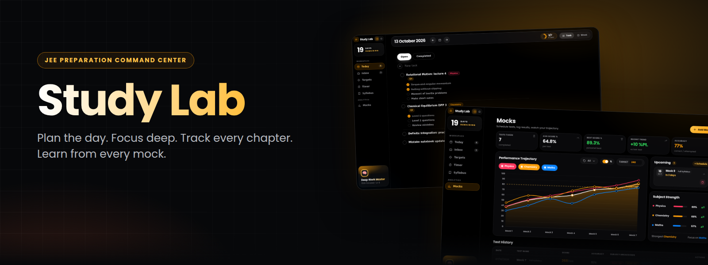
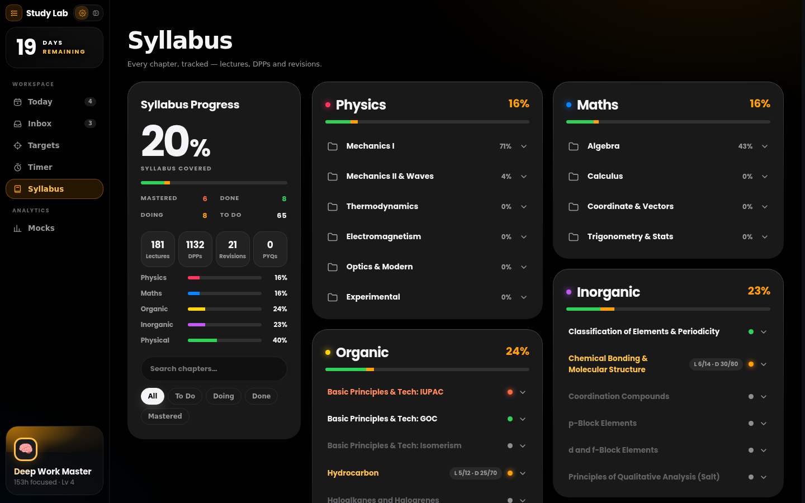
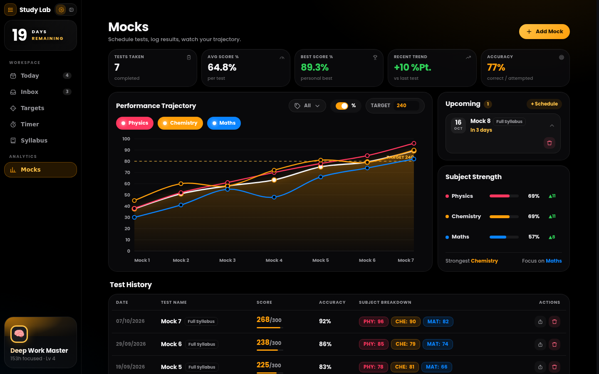

<div align="center">



<br>

[](#-tech-stack)
[](#-tech-stack)
[](#-tech-stack)
[](#-getting-started)
[](#-deploy-to-netlify)

**Plan the day. Focus deep. Track every chapter. Learn from every mock.**

[Preview](#-preview) &nbsp;•&nbsp; [Features](#-features) &nbsp;•&nbsp; [Tech Stack](#-tech-stack) &nbsp;•&nbsp; [Getting Started](#-getting-started) &nbsp;•&nbsp; [Your Data](#-your-data--privacy)

</div>

<br>

## ✦ Overview

**Study Lab** is a single-page, dark-themed study dashboard built for JEE preparation. It brings the things a serious aspirant juggles every day into one fast, distraction-free workspace: a daily task planner, a focus timer with streaks and levels, a chapter-wise syllabus tracker, and a mock-test analytics board.

It runs entirely in the browser. There is no backend, no account, no framework and no build step, just three files.

<br>

## ✦ Preview

<table>
  <tr>
    <td width="50%" align="center">
      <br>
      <sub><b>Today</b>: tasks, subtasks, subject tags and a daily progress ring</sub>
    </td>
    <td width="50%" align="center">
      <br>
      <sub><b>Week</b>: timed blocks and all-day items across the week</sub>
    </td>
  </tr>
  <tr>
    <td width="50%" align="center">
      <br>
      <sub><b>Focus</b>: Flow, Pomodoro and Custom timers with streak stats</sub>
    </td>
    <td width="50%" align="center">
      <br>
      <sub><b>Syllabus</b>: every chapter tracked by status, lectures, DPPs and PYQs</sub>
    </td>
  </tr>
  <tr>
    <td width="50%" align="center">
      <br>
      <sub><b>Mocks</b>: score trajectory, subject strength and test history</sub>
    </td>
    <td width="50%" align="center">
      <br>
      <sub><b>Settings</b>: countdown, tag colors, backgrounds and backups</sub>
    </td>
  </tr>
</table>

<br>

## ✦ Features

### 🗓️ Plan

| Module | What it does |
| :-- | :-- |
| **Today** | Add tasks in one line, click to complete, double-click to edit. Subject tags, due dates, subtasks with live progress, drag-to-reorder, and a daily completion ring. |
| **Week** | A week planner with timed blocks and all-day items. Scheduled mocks show up here automatically. |
| **Inbox** | Capture now, schedule later. Dump ideas fast and sort them into days when you are ready. |
| **Targets** | Weekly and long-term targets with deadlines. Move each target across the board as you make progress. |

### 🎯 Focus

| Module | What it does |
| :-- | :-- |
| **Timer** | Three modes (**Flow**, **Pomodoro**, **Custom**) plus manual session logging. Pick a subject and link a task to every session. |
| **Stats** | Study streak, focused time today, 7-day average and peak, and 30-day consistency. |
| **Levels & Badges** | Seven ranks from **Novice** to **Ascended**, driven by your focused hours, plus a large set of achievement badges. |
| **Share Card** | Export a PNG card of your day. The front shows your profile and today's tasks, the back shows subject-wise hours. |

### 📚 Track

| Module | What it does |
| :-- | :-- |
| **Syllabus** | Physics, Chemistry (Organic, Inorganic, Physical) and Maths, broken into folders and chapters. Mark each as To Do, Doing, Done or Mastered. |
| **Chapter Progress** | Track lectures, DPPs, revisions and PYQs against targets. Search and filter by status. |
| **Task Linking** | Link a task to a chapter as a lecture, DPP or revision, and the syllabus updates when you finish it. |

### 📈 Analyse

| Module | What it does |
| :-- | :-- |
| **Mocks** | Schedule tests, log marks per subject, and record attempted and correct counts for accuracy. |
| **Insights** | Performance trajectory chart with a target line, subject strength, recent trend, best score and full test history. |

### ⚙️ Personalise

| Setting | What it does |
| :-- | :-- |
| **Countdown** | Choose your target session (Jan or April), set the exact shift date, and add a photo, GIF or video banner. |
| **Appearance** | Custom subject tag colors, built-in atmospheres (Aurora, Ember, Neon Grid, Midnight, Ink Waves), a custom image URL and adjustable background opacity. |
| **Day Rollover** | Decide when your day ends (12 AM to 6 AM), so late-night study counts for the right day. |
| **Backup** | Export all your data to a JSON file and import it back anywhere. |

<br>

## ✦ Tech Stack

| Layer | Technology |
| :-- | :-- |
| **Markup** | HTML5 |
| **Styling** | CSS3 with custom properties, grid and flexbox, and CSS animations |
| **Logic** | Vanilla JavaScript, no framework or library |
| **Isolation** | Shadow DOM (`attachShadow`) keeps the app's styles self-contained |
| **Graphics** | Inline SVG icons and the Canvas API for the share card |
| **Storage** | Browser `localStorage` |
| **Fonts** | Bricolage Grotesque and Instrument Sans via Google Fonts |

<br>

## ✦ Project Structure

```text
jee-study-lab/
├── index.html     # Markup, favicon, and the Shadow DOM template with its styles
├── style.css      # Document-level styles
├── app.js         # All application logic
├── *.png          # Banner and screenshots used in this README
└── README.md
```

<br>

## ✦ Getting Started

No installation needed. Clone the repo and open it.

```bash
git clone https://github.com/dev-atharv07/jee-study-lab.git
cd jee-study-lab
```

Then do either of these:

- Double-click `index.html`, or
- In VS Code, install **Live Server**, right-click `index.html`, and choose **Open with Live Server**.

> [!IMPORTANT]
> Keep `index.html`, `style.css` and `app.js` in the same folder and do not rename them. `index.html` loads the other two by exact name.

### 🌐 Deploy to Netlify

1. Push this repo to GitHub.
2. In Netlify, choose **Add new site → Import an existing project** and pick the repo.
3. Leave the **build command** empty and set the **publish directory** to `/` (the repo root).
4. Deploy. The app is served from `index.html` at the site root.

Prefer drag and drop? Drag the project **folder** (not a ZIP) onto the Netlify Deploys page. `index.html` must sit at the top level of that folder.

<br>

## ✦ Your Data & Privacy

- Everything is stored **locally in your browser** (`localStorage`). Nothing is sent to any server.
- Data is **per browser and per device**. Clearing site data or switching browsers starts you from scratch.
- Use **Settings → Day & Data → Export All Data** regularly to keep a backup, and **Import Data** to restore it.

<br>

## ✦ Development Notes

- **Do not run Prettier on `index.html`.** It contains an inline `<template>` with styles that are copied into a Shadow DOM, and reformatting it can break the layout. Formatting `style.css` and `app.js` is safe.
- After deploying changes, do a hard refresh (`Ctrl + Shift + R`) so the browser does not keep serving old cached files. The asset links carry a `?v=` version in `index.html` for the same reason, so bump that number when you update.

<br>

<div align="center">

Built with focus by **[@dev-atharv07](https://github.com/dev-atharv07)**

<sub>Made for aspirants who treat every day like a mock test. 🧡</sub>

</div>
