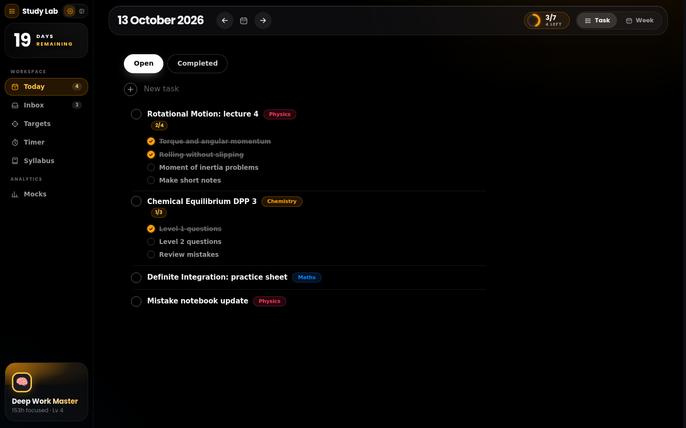
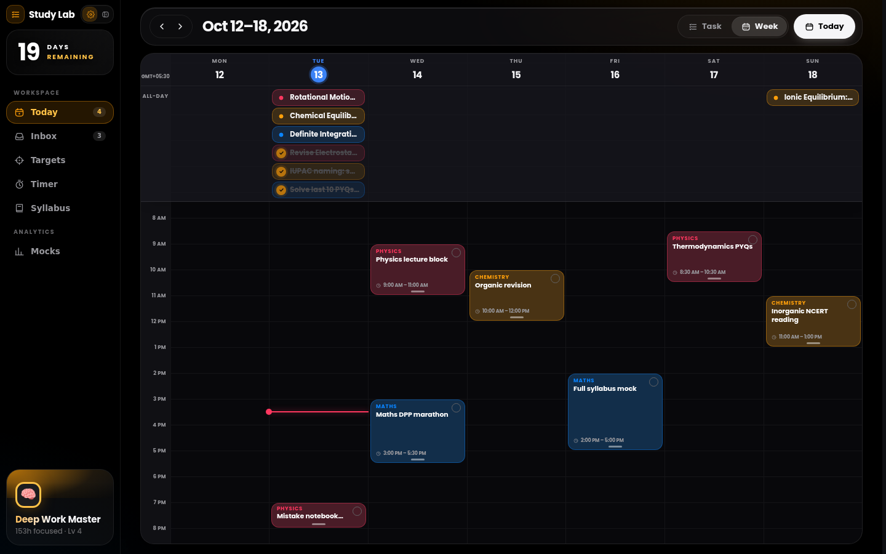
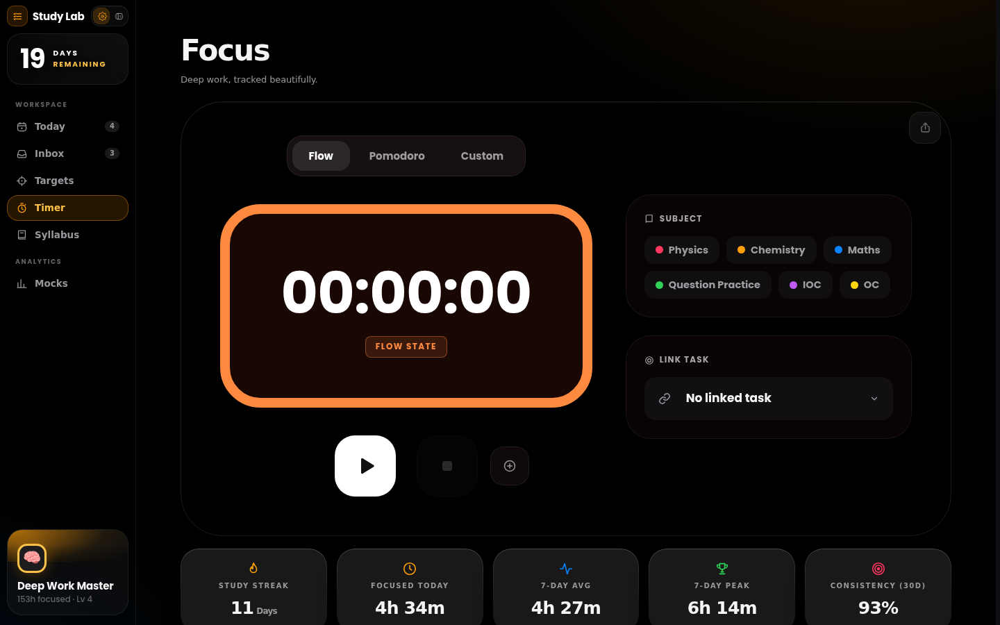
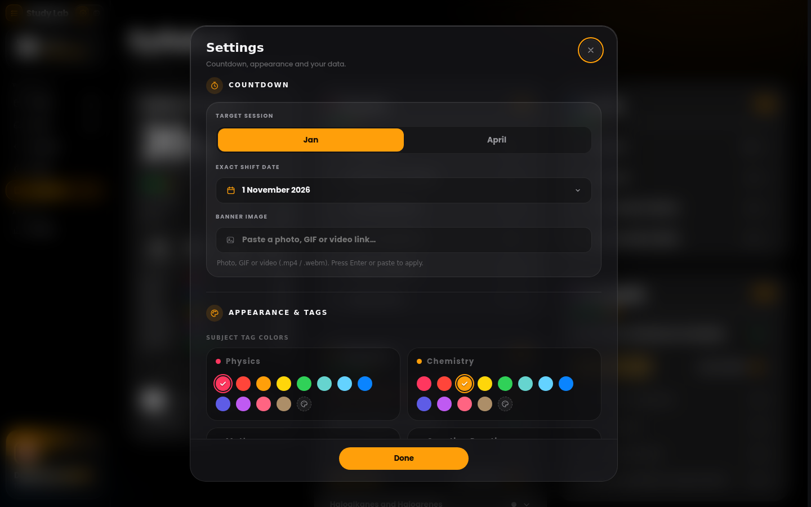
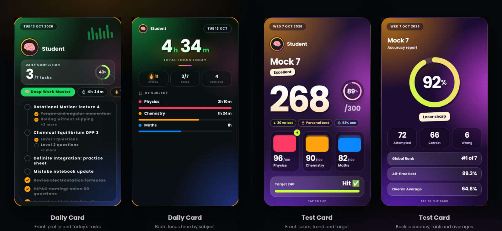
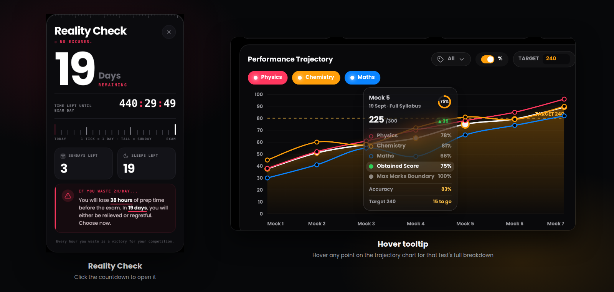

<div align="center">


<br>

[](#-tech-stack)
[](#-tech-stack)
[](#-tech-stack)
[](#-quick-start)
[](#-your-data--privacy)
[](#-quick-start)

### Plan the day. Focus deep. Track every chapter. Learn from every mock.

[**Preview**](#-preview) &nbsp;•&nbsp; [**Share Cards**](#-share-cards) &nbsp;•&nbsp; [**Reality Check**](#-reality-check--chart-insights) &nbsp;•&nbsp; [**Features**](#-everything-inside) &nbsp;•&nbsp; [**Quick Start**](#-quick-start) &nbsp;•&nbsp; [**Privacy**](#-your-data--privacy)

</div>

<br>

## ✦ Overview

**Study Lab** is a single-page, dark-themed study dashboard built for JEE preparation. It puts everything a serious aspirant juggles every day into one fast, distraction-free workspace: a daily planner, a focus timer with streaks and levels, a chapter-wise syllabus tracker and a mock-test analytics board.

It runs entirely in the browser. No backend, no account, no framework and no build step.

<div align="center">

| 🧭 **7** | 🏅 **7** | 📄 **3** | 🛰️ **0** |
| :---: | :---: | :---: | :---: |
| Views | Ranks to unlock | Files in total | Servers needed |

</div>

<br>

## ✦ Highlights

<table>
  <tr>
    <td width="33%" valign="top">
      <h3>🗓️ Plan</h3>
      <p>Add tasks in one line, break them into subtasks, drag to reorder, and lay your week out in timed blocks.</p>
    </td>
    <td width="33%" valign="top">
      <h3>🎯 Focus</h3>
      <p>Flow, Pomodoro and Custom timers with streaks, a 30-day consistency score, seven ranks and achievement badges.</p>
    </td>
    <td width="33%" valign="top">
      <h3>📚 Track</h3>
      <p>Every chapter of Physics, Chemistry and Maths by status, with lectures, DPPs, revisions and PYQs counted.</p>
    </td>
  </tr>
  <tr>
    <td width="33%" valign="top">
      <h3>📈 Analyse</h3>
      <p>Log marks per subject, see accuracy, and watch your score trajectory against a target line.</p>
    </td>
    <td width="33%" valign="top">
      <h3>🪪 Share</h3>
      <p>Flip cards for your day and for every mock test. Export the daily card as a PNG.</p>
    </td>
    <td width="33%" valign="top">
      <h3>🔒 Private</h3>
      <p>Everything lives in your browser. Back it up to a JSON file and restore it anywhere.</p>
    </td>
  </tr>
</table>

<br>

## ✦ Preview

<table>
  <tr>
    <td width="50%" align="center">
      <br>
      <sub><b>Today</b>: tasks, subtasks, subject tags and a daily progress ring</sub>
    </td>
    <td width="50%" align="center">
      <br>
      <sub><b>Week</b>: timed blocks and all-day items across the week</sub>
    </td>
  </tr>
  <tr>
    <td width="50%" align="center">
      <br>
      <sub><b>Focus</b>: Flow, Pomodoro and Custom timers with streak stats</sub>
    </td>
    <td width="50%" align="center">
      <br>
      <sub><b>Syllabus</b>: every chapter tracked by status, lectures, DPPs and PYQs</sub>
    </td>
  </tr>
  <tr>
    <td width="50%" align="center">
      <br>
      <sub><b>Mocks</b>: score trajectory, subject strength and test history</sub>
    </td>
    <td width="50%" align="center">
      <br>
      <sub><b>Settings</b>: countdown, tag colors, backgrounds and backups</sub>
    </td>
  </tr>
</table>

<br>

## ✦ Share Cards

Turn your progress into a card you can screenshot. Every card flips: tap it to see the other side.

<div align="center">
  
</div>

<br>

| Card | Front | Back |
| :-- | :-- | :-- |
| **🗓️ Daily Card** | Your profile, rank badge, daily completion ring and today's tasks with subtasks. | Total focus time today, streak, tasks done, sessions, and hours per subject. |
| **📝 Test Card** | Mock name, score out of max, percentage ring, change vs last test, personal-best badge, subject marks and target status. | Accuracy report with attempted, correct and wrong counts, rank among your tests, all-time best and overall average. |

> [!TIP]
> **Daily Card:** open it from the share button on the **Timer** page and export it as a high-resolution **1080 × 1920 PNG**, sized for stories and status.
>
> **Test Card:** open it from the share icon on any test in **Mocks → Test History**. Strong results, like a personal best or a hit target, get a little celebration.

<br>

## ✦ Reality Check & Chart Insights

<div align="center">
  
</div>

<br>

<table>
  <tr>
    <td width="50%" valign="top">
      <h3>⏳ Reality Check</h3>
      <p>Click the countdown in the sidebar. See days remaining, a live <code>HH:MM:SS</code> clock to exam day, a one-tick-per-day ruler (taller ticks are Sundays), Sundays and sleeps left, and how many prep hours you lose if you waste 2 hours a day. All of it is calculated from your target date.</p>
    </td>
    <td width="50%" valign="top">
      <h3>🎯 Chart Tooltip</h3>
      <p>Hover any point on the <b>Performance Trajectory</b> chart. A card shows the test name, date and category, score out of max, change vs the previous test, marks per subject, accuracy, and how far you are from your target.</p>
    </td>
  </tr>
</table>

<br>

## ✦ Everything Inside

Open a group to see every module.

<details>
<summary><b>🗓️ Plan</b> &nbsp;·&nbsp; Today, Week, Inbox, Targets</summary>

<br>

| Module | What it does |
| :-- | :-- |
| **Today** | Add tasks in one line, click to complete, double-click to edit. Subject tags, due dates, subtasks with live progress, drag-to-reorder, and a daily completion ring. |
| **Week** | A week planner with timed blocks and all-day items. Scheduled mocks show up here automatically. |
| **Inbox** | Capture now, schedule later. Dump ideas fast and sort them into days when you are ready. |
| **Targets** | Weekly and long-term targets with deadlines. Move each target across the board as you make progress. |

</details>

<details>
<summary><b>🎯 Focus</b> &nbsp;·&nbsp; Timer, Stats, Levels, Daily Card</summary>

<br>

| Module | What it does |
| :-- | :-- |
| **Timer** | Three modes (**Flow**, **Pomodoro**, **Custom**) plus manual session logging. Pick a subject and link a task to every session. |
| **Stats** | Study streak, focused time today, 7-day average and peak, and 30-day consistency. |
| **Levels & Badges** | Seven ranks driven by your focused hours, plus a large set of achievement badges. |
| **Daily Card** | A flip card of your day. The front shows your profile and today's tasks, the back shows subject-wise hours. Export it as a PNG. |

**Rank ladder**

| 🌱 Novice | 📘 Apprentice | 🎓 Scholar | 🧠 Deep Work Master | 👑 Legend | 🐉 Mythic | 🌌 Ascended |
| :---: | :---: | :---: | :---: | :---: | :---: | :---: |
| 0h | 10h | 50h | 100h | 250h | 500h | 1000h |

</details>

<details>
<summary><b>📚 Track</b> &nbsp;·&nbsp; Syllabus, Chapter Progress, Task Linking</summary>

<br>

| Module | What it does |
| :-- | :-- |
| **Syllabus** | Physics, Chemistry (Organic, Inorganic, Physical) and Maths, broken into folders and chapters. Mark each as To Do, Doing, Done or Mastered. |
| **Chapter Progress** | Track lectures, DPPs, revisions and PYQs against targets. Search and filter by status. |
| **Task Linking** | Link a task to a chapter as a lecture, DPP or revision, and the syllabus updates when you finish it. |

</details>

<details>
<summary><b>📈 Analyse</b> &nbsp;·&nbsp; Mocks, Insights, Test Card</summary>

<br>

| Module | What it does |
| :-- | :-- |
| **Mocks** | Schedule tests, log marks per subject, and record attempted and correct counts for accuracy. |
| **Insights** | Performance trajectory chart with a target line and hover tooltips, subject strength, recent trend, best score and full test history. |
| **Test Card** | A shareable card for every mock: score, trend vs last test, personal best, target status, plus an accuracy report with your rank among all tests. |

</details>

<details>
<summary><b>⚙️ Personalise</b> &nbsp;·&nbsp; Countdown, Appearance, Day Rollover, Backup</summary>

<br>

| Setting | What it does |
| :-- | :-- |
| **Countdown** | Choose your target session (Jan or April), set the exact shift date, and add a photo, GIF or video banner. Click it anytime for a **Reality Check**. |
| **Appearance** | Custom subject tag colors, built-in atmospheres (Aurora, Ember, Neon Grid, Midnight, Ink Waves), a custom image URL and adjustable background opacity. |
| **Day Rollover** | Decide when your day ends (12 AM to 6 AM), so late-night study counts for the right day. |
| **Backup** | Export all your data to a JSON file and import it back anywhere. |

</details>

<br>

## ✦ Quick Start

No installation needed.

**1. Clone the repo**

```bash
git clone https://github.com/dev-atharv07/jee-study-lab.git
cd jee-study-lab
```

**2. Open it** with either of these:

- Double-click `index.html`, or
- In VS Code, install **Live Server**, right-click `index.html`, and choose **Open with Live Server**.

> [!IMPORTANT]
> Keep `index.html`, `style.css` and `app.js` in the same folder and do not rename them. `index.html` loads the other two by exact name.

<details>
<summary><b>🌐 Deploy to Netlify</b></summary>

<br>

1. Push this repo to GitHub.
2. In Netlify, choose **Add new site → Import an existing project** and pick the repo.
3. Leave the **build command** empty and set the **publish directory** to `/` (the repo root).
4. Deploy. The app is served from `index.html` at the site root.

Prefer drag and drop? Drag the project **folder** (not a ZIP) onto the Netlify Deploys page. `index.html` must sit at the top level of that folder.

</details>

<br>

## ✦ Tech Stack

<div align="center">

| Markup | Styling | Logic | Isolation | Graphics | Storage |
| :---: | :---: | :---: | :---: | :---: | :---: |
| HTML5 | CSS3 variables, grid, flexbox, animations | Vanilla JavaScript | Shadow DOM | Inline SVG and Canvas API | Browser `localStorage` |

</div>

<sub>Fonts: Bricolage Grotesque and Instrument Sans via Google Fonts. No framework, no library, no build tooling.</sub>

<details>
<summary><b>📁 Project structure</b></summary>

<br>

```text
jee-study-lab/
├── index.html     # Markup, favicon, and the Shadow DOM template with its styles
├── style.css      # Document-level styles
├── app.js         # All application logic
├── assets/        # Banner and screenshots used in this README
└── README.md
```

</details>

<br>

## ✦ Your Data & Privacy

- 🔒 Everything is stored **locally in your browser** (`localStorage`). Nothing is sent to any server.
- 🖥️ Data is **per browser and per device**. Clearing site data or switching browsers starts you from scratch.
- 💾 Use **Settings → Day & Data → Export All Data** regularly to keep a backup, and **Import Data** to restore it.

<br>

## ✦ Behind the Code

Nerd snipe alert 🤓. If you're wondering why I completely ghosted React and Tailwind, how the zero-drift local timer actually works, or why I shipped this entire command centre from pure vanilla scratch, I wrote a full deep dive on it:

👉 [**Read the Engineering Breakdown**](https://ath4rvv.github.io/#writes)

## ✦ Acknowledgements

Study Lab is built from scratch as my personal execution engine. However, clean design deserves recognition.

- The UI layout and visual architecture for the **Focus Timer** and **Mock-Test Analytics** modules are heavily inspired by [ChaosPrep](https://chaosprep.com/).
- All the underlying logic (HTML, CSS, Vanilla JS) has been coded independently to match the local-first, zero-bloat philosophy of this project. A huge shoutout to the ChaosPrep team for establishing such intuitive design patterns in the ed-tech space.

<br>

## ✦ Development Notes

> [!WARNING]
> **Do not run Prettier on `index.html`.** It contains an inline `<template>` with styles that are copied into a Shadow DOM, and reformatting it can break the layout. Formatting `style.css` and `app.js` is safe.

> [!NOTE]
> After deploying changes, do a hard refresh (`Ctrl + Shift + R`) so the browser does not keep serving old cached files. The asset links carry a `?v=` version in `index.html` for the same reason, so bump that number when you update.

<br>

<div align="center">

Built with focus by **[@ath4rvv](https://github.com/ath4rvv)**

<sub>Made for aspirants who treat every day like a mock test. 🧡</sub>

</div>
